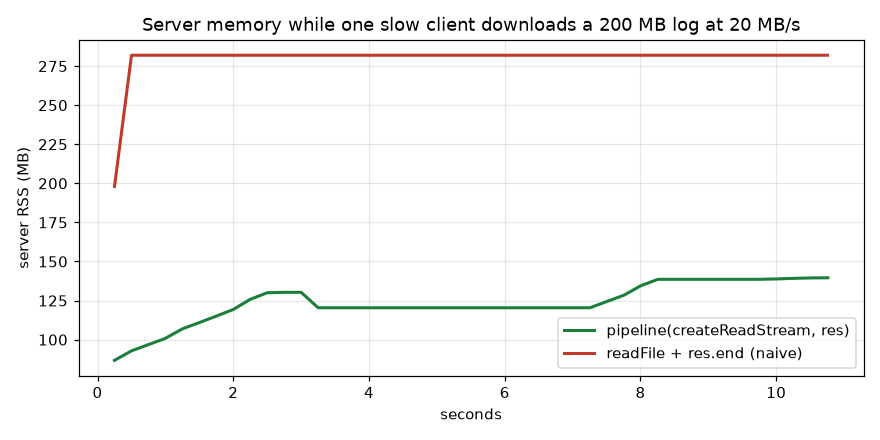

# Lab 4 — Node.js server: EventEmitter, streams, WebSocket

## Run

```bash
npm install
npm run build                   # client/dist
npm run dev:server              # node --watch --env-file=.env (server/.env from .env.example)
npm run dev:client              # Vite on :5173, proxies /api and /ws to :3000
npm test                        # server 20 tests + client 13 tests
/tmp/e2e-venv/bin/python e2e/lab4.py   # real server + 2 real Firefox windows (13 checks)
```

## What was built

| Piece | File |
|---|---|
| env config, validated | `server/src/config.js` |
| versioned, validated JSON protocol | `server/src/protocol.js` |
| `Room extends EventEmitter`, `RoomManager` | `server/src/rooms.js` |
| socket lifecycle, heartbeat, rate limit, slow-client policy | `server/src/ws.js`, `rate-limit.js` |
| static serving with traversal guard, API, replay streaming, graceful stop | `server/src/static.js`, `server.js`, `index.js` |
| match log: object-mode `Transform` + `pipeline`; replay generator | `server/src/log/` |
| client `Connection` (queue, backoff, re-hello), chat panel | `client/src/net/connection.js`, `ui/chat.js` |

Close codes: 1001 shutdown, 1009 payload too big, 4000 bad protocol, 4001 join timeout, 4002 rate limit, 4003 room full, 4004 no such room, 4005 slow client.

## Bugs found by the tests while building this

1. Seeded rooms were created before the `created` listener existed, so they never got a match log.
2. The match log subscribed after `await mkdir(...)`, so the very `join` event that triggered it was lost. Fix: call `events.on()` synchronously, before the first `await`.

## Event loop: blocking demo (`server/scripts/blocking-demo.mjs`)

One client sends a chat message every 25 ms and measures the echo time. A second client calls `/api/slow` (a 300 ms synchronous busy loop) in a loop.

| Condition | n | p50 | p99 | max |
|---|---|---|---|---|
| idle | 113 | 1.2 ms | 2.4 ms | 2.4 ms |
| while `/api/slow` runs | 11 | 279.9 ms | 283.1 ms | 283.1 ms |

Node runs your JavaScript on one thread. While the handler spins, no timer, socket or other request is serviced, so every connected player stalls together. Sample count also drops from 113 to 11 for the same 3 s.

## Backpressure (`server/scripts/backpressure.mjs`)

A real 200 MB NDJSON log, downloaded by a client that reads at 20 MB/s, sampling the **server** RSS every 250 ms:



| Endpoint | RSS before | peak | growth |
|---|---|---|---|
| `pipeline(createReadStream, res)` | 81 MB | 140 MB | **58 MB** (bounded plateau) |
| `readFile` + `res.end` (naive) | 82 MB | 282 MB | **200 MB** (whole file) |

The pipeline curve is not perfectly flat: it climbs about 58 MB during the first seconds (V8 warm-up, socket buffers, GC timing) and then plateaus; it does not scale with file size. The naive version jumps by the full file size immediately. Caveat: the reader here is throttled in-process at 20 MB/s, not through a DevTools-throttled browser, and a 200 MB file only needs about 11 s at that rate, so this shows the memory behaviour but not a truly slow mobile client.

## Why unhandled errors kill the server (`server/scripts/crash-demo.mjs`)

```
$ node crash-demo.mjs error
Error: socket exploded
Emitted 'error' event at: ...                 -> exit code 1
$ node crash-demo.mjs rejection
Error: db write failed                        -> exit code 1
```

An `'error'` event with no listener is thrown; a rejected promise nobody handles is an `unhandledRejection`, and since Node 15 that terminates the process. Both are deliberate: continuing after an unknown failure risks corrupt state. Fix: an `'error'` listener on every emitter (`Room`, `RoomManager`, every socket) and `.catch`/`await` in `try` for every promise. With the fixes both demos print `handled:` and exit 0.

## Not verified

- The Vite dev proxy (`/api`, `/ws` to :3000) was configured but not exercised in a browser; the end-to-end test runs against the production server serving `client/dist`.
- The tag `lab-04` is a local tag in the coursework repo, not a pushed tag on a GitHub repo.
