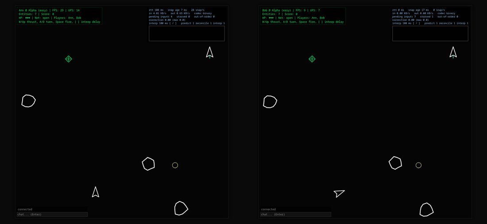

# Lab 5 — Authoritative server, prediction, interpolation, binary protocol



*The GIF is assembled from 70 real Selenium window captures (about 3 frames per second, 100 +- 30 ms and 2% loss injected), so it is a slideshow, not smooth video. Both windows are real Firefox instances talking to the real server.*

## Run

```bash
npm install
npm run build
npm test                                   # shared 18 + server 42 + client 24
npm run bench -w shared                    # JSON vs binary table
ENABLE_NETSIM=1 npm start                  # server with the latency injector enabled
/tmp/e2e-venv/bin/python e2e/lab5.py       # 2 real Firefox windows, 11 checks
/tmp/e2e-venv/bin/python e2e/lab5_gif.py   # records the GIF
```

Browser switches: `?predict=0&reconcile=0&interp=0&delay=100&codec=json&lag=100&jitter=30&drop=2&breakdet=1`.
`lag/jitter/drop` only work when the server runs with `ENABLE_NETSIM=1`. `[` and `]` change the interpolation delay live.

## Layout

| Piece | Where |
|---|---|
| pure seeded sim (no DOM, no Node, no `Math.random`) | `shared/src/sim/`, `rng.js`, `state.js`, `hash.js` |
| protocol, JSON and binary codecs | `shared/src/protocol.js`, `codec/` |
| 30 Hz `Match`, absolute-target timer | `server/src/match.js` |
| latency / jitter / drop injector | `server/src/netsim.js` |
| `GameClient` (prediction, reconcile, interpolate; no DOM) | `client/src/net/gameclient.js` |
| netgraph | `client/src/ui/netgraph.js` |
| virtual-time netcode harness | `client/tests/netsim-harness.mjs` |

## Measurements

Bench (4 players, 12 asteroids, 19-38 entities, 30 snapshots/s):

| Codec | Bytes/snapshot | KB/s per client (down) | KB/s per client (up, 3 inputs/packet) | Encode / decode us |
|---|---|---|---|---|
| JSON (full precision) | 4734 | 138.7 | 5.33 (182 B) | 12.9 / 30.9 |
| JSON (rounded to 3 dp, fairer) | 3031 | 88.8 | 5.33 | 11.7 / 27.2 |
| Binary (`DataView`) | 833 | 24.4 | 0.64 (22 B) | 7.1 / 4.8 |

On the live link in the e2e run: binary 6.4 KB/s in vs JSON 35.0 KB/s in (different moments of the game, so only the order of magnitude is meaningful).

Corrections in the virtual-time harness (mean / p95, world units):

| Scenario | mean | p95 |
|---|---|---|
| 100 ms, clean, binary | 0.0003 | 0.0007 |
| 100 ms, JSON (no quantization) | 0.0000 | 0.0000 |
| 100+-30 ms, 2% loss, 30 s | steady state tiny; one 471-unit spike = a respawn teleport | 0.001 |
| deterministic sim | 0.0003 | 0.0007 |
| `Math.random()` in client physics | 0.033 | 0.068 |
| reconcile off | 0.025 | 0.207 |

Real browsers: with `breakdet=1` the netgraph shows repeated correction spikes (max 16.7) while the deterministic client stays near zero in open space (`docs/lab5-shots/bad-determinism.png` vs `good-determinism.png`). Thrust is visible after about 38-48 ms with prediction and about 160 ms without (harness at 100 ms RTT).

## Netcode write-up

**Latency.** The server is the only authority; clients send inputs. A ship driven only by snapshots answers one RTT late. With prediction the client runs the same shared `Ship.update` immediately, so thrust shows within one 33 ms step.

**Consistency.** Every input has a `seq`; every snapshot carries `ack`, the last `seq` the server consumed for that player. On a snapshot the client takes the server state, drops inputs with `seq <= ack`, replays the rest, and fades the remaining jump out over about 100 ms. Remote entities are drawn 100 ms in the past between the two snapshots that bracket that time; entities that appear or vanish between snapshots are handled, and a jump above 60 units is treated as a teleport (respawn), not interpolated. Own bullets are predicted at once and replaced by the server bullet matched through `fireSeq`. Inputs are sent redundantly (last 3 per packet), so a lost packet is covered by the next one.

**Cheating.** Clients never send positions. Inputs are sanitized (turn is clamped to -1..1, booleans coerced), size-limited, and rate-limited by a separate token bucket.

**The determinism bug I hit.** Two runs of the same world with the same seed produced different hashes. Cause: a static, global entity-id counter inside `Entity` leaked state between worlds, so the second world started numbering where the first ended. Fix: each `World` owns its id counter and assigns ids in `spawn`. This is exactly the kind of bug that makes a predicting client drift from the server. A second bug of the same family, found late: `Ship`, `Bullet` and `Pickup` constructors dropped the `id` option, so client proxies all had id 0 and the netcode tests found no own ship; fixed by forwarding `id`.

**Interpolation delay trade-off.** 100 ms (3 ticks) tolerates one lost snapshot (2 intervals = 66 ms plus jitter) without the buffer running dry (`starved` counter in the netgraph). Lower is more current but stutters under loss; higher is smooth but you see others further in the past, which hurts aiming (lag compensation is not implemented).

## Not done / not verified

- Audio was not tested (user asked to skip sound testing); the Lab 5 e2e scripts mute Firefox (`media.volume_scale=0`).
- The homing missile (H) is removed from the networked client; the server does not simulate it.
- Explosions are not replicated, so remote kills show no explosion effect.
- Delta compression and lag compensation (stretch) are not implemented.
- Real-world networks and a second physical machine were not used; latency is injected by `NetSim`.
- Tag is `js-lab-05` (kept the per-lab naming from Lab 4), local only, not pushed.
